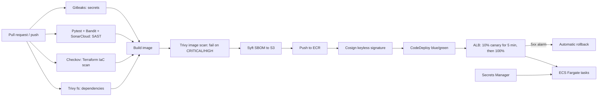
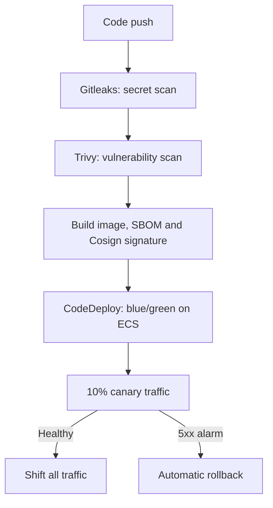

# DevSecOps CI/CD with Blue/Green Deployments on ECS Fargate

A pipeline where **insecure code, vulnerable images and misconfigured infrastructure cannot reach production**, and where a bad release **rolls itself back** automatically.

## Architecture



## Security gates

| Stage | Tool | Blocks the pipeline when |
|---|---|---|
| Secret scanning | Gitleaks | A credential is found in the repo history |
| SAST | SonarCloud, Bandit | Bandit high-severity findings (Sonar quality gate if configured) |
| IaC scanning | Checkov | Misconfiguration found (unless `CHECKOV_SOFT_FAIL=true`) |
| Dependency scan | Trivy (fs) | Fixable CRITICAL/HIGH CVE |
| Container scan | Trivy (image) | Fixable CRITICAL/HIGH CVE |
| Supply chain | Syft SBOM + Cosign | SBOM stored per commit in S3; image signed with keyless OIDC identity |

## Deployment strategy

ECS service uses the `CODE_DEPLOY` controller with two ALB target groups (blue/green) and two listeners:
port **80** serves production, port **8080** is a test listener for the new version.
`ECSCanary10Percent5Minutes` shifts 10% of traffic first, then the rest. A CloudWatch alarm on target 5xx errors
(and any deployment failure) triggers an **automatic rollback**. The old tasks are kept for 5 minutes after success.

## Repository layout

```
app/                  Flask service, Dockerfile, tests
ecs/appspec.yaml      CodeDeploy AppSpec
terraform/            VPC, ALB (2 TGs), ECS, CodeDeploy, alarms, Secrets Manager, ECR, S3 SBOM bucket, GitHub OIDC role
.github/workflows/    devsecops.yml (main pipeline), terraform.yml
.gitleaks.toml  sonar-project.properties  .trivyignore
```

## Setup

1. **Infrastructure**
   ```bash
   cd terraform
   cp terraform.tfvars.example terraform.tfvars   # set github_org and a unique sbom_bucket_name
   terraform init && terraform apply
   terraform output
   ```
2. **GitHub secret:** `AWS_ROLE_ARN` = output `github_actions_role_arn`.
3. **GitHub variables** (*Settings > Secrets and variables > Actions > Variables*): create the 7 variables listed in the output `names_for_github_variables` (`ECS_CLUSTER`, `ECS_SERVICE`, `ECS_TASK_FAMILY`, `CODEDEPLOY_APP`, `CODEDEPLOY_DG`, `ECR_REPOSITORY`, `SBOM_BUCKET`).
4. **Optional SonarCloud:** create a free account at sonarcloud.io, import the repo, edit `sonar-project.properties`, and add secret `SONAR_TOKEN`. The step is skipped when the secret is absent.
5. **First run:** push to `main`. The initial ECS tasks reference a placeholder image tag, so the first pipeline run replaces them with the real image.
6. **Open the app:** `curl http://$(terraform output -raw alb_dns_name)/`

> If Checkov fails on first run, review the findings, fix or skip with justification, or set repo variable `CHECKOV_SOFT_FAIL=true` while tuning.

## Demo scenarios (great for screenshots / video)

- **Secret blocked:** commit a fake `AKIA...` key on a branch, open a PR, and watch Gitleaks fail.
- **Vulnerability blocked:** pin an old library in `requirements.txt` and watch Trivy fail the build.
- **Auto rollback:** change `/health` to return 500 (or make `/` raise errors), deploy, and watch CodeDeploy stop and roll back.
- **Verify signature:**
  ```bash
  cosign verify <ecr-image@digest> \
    --certificate-identity-regexp "https://github.com/<you>/devsecops-ecs-bluegreen/.*" \
    --certificate-oidc-issuer https://token.actions.githubusercontent.com
  ```

## Production hardening (what I would add next)

HTTPS with ACM, WAF on the ALB, VPC endpoints instead of NAT, admission-time signature verification, branch protection with required checks.

## Cost and cleanup

Fargate (2 small tasks), ALB and a NAT gateway cost roughly **$3-4/day**. Destroy when finished:
```bash
cd terraform && terraform destroy
```

## Screenshots

**Pipeline: every security gate passes before deploy**


**Gitleaks blocks a committed credential**


**Trivy fails the build on a critical/high CVE**


**CodeDeploy blue/green canary: 10% traffic shift**


**Automatic rollback after the 5xx alarm fires**


**SBOM stored per commit in S3**


**Cosign signature verification succeeds**


## Resume bullet

> Built a DevSecOps CI/CD pipeline integrating secret, SAST, IaC, dependency and container scanning with SBOM generation and keyless Cosign image signing; deployed via CodeDeploy blue/green canary releases on ECS Fargate with CloudWatch-alarm-driven automatic rollback.


## Planned pipeline design
> Design diagram only. Deployment screenshots will be added later.


